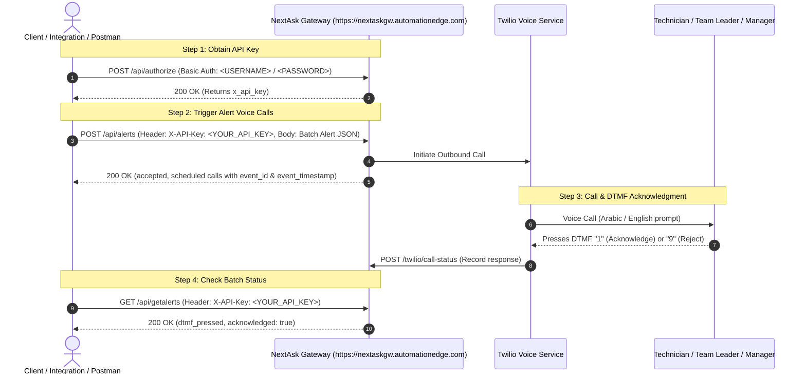

# NextAsk Gateway API Documentation

**Base URL:** `https://nextaskgw.automationedge.com`  
**Authentication Scheme:** `Basic Auth` (to generate API key) & `X-API-Key` (for platform endpoints)

---

## Table of Contents
1. [Overview & Authentication Flow](#1-overview--authentication-flow)
2. [Authorization API (`/api/authorize`)](#2-authorization-api)
3. [Authentication API (`/api/authenticate`)](#3-authentication-api)
4. [Alert Intake API (`/api/alerts`)](#4-alert-intake-api)
5. [Payload Field Specifications & PostgreSQL Data Types](#5-payload-field-specifications--postgresql-data-types)
6. [Get Alerts API (`/api/getalerts`)](#6-get-alerts-api)
7. [Twilio Webhooks](#7-twilio-webhooks)
   - [Voice Callback (`/twilio/voice`)](#71-voice-callback)
   - [Call Status Callback (`/twilio/call-status`)](#72-status-callback)
8. [Error Handling & HTTP Status Codes](#8-error-handling--http-status-codes)

---

## 1. Overview & Authentication Flow



---

## 2. Authorization API

Authenticates admin credentials and returns the active API Key required for all subsequent requests.

* **Endpoint:** `/api/authorize`
* **Method:** `POST` or `GET`
* **Authentication:** **Basic Auth** (`<USERNAME>` / `<PASSWORD>`) or JSON Body (`{"username": "<USERNAME>", "password": "<PASSWORD>"}`)

### Request Headers
| Header | Value | Required |
| :--- | :--- | :--- |
| `Authorization` | `Basic <BASE64_ENCODED_CREDENTIALS>` | **Yes** (or JSON body) |
| `Content-Type` | `application/json` | If sending JSON body |

### Request Body (Optional if using Basic Auth)
```json
{
  "username": "<YOUR_USERNAME>",
  "password": "<YOUR_PASSWORD>"
}
```

### Success Response (`200 OK`)
```json
{
  "status": "success",
  "authorized": true,
  "http_code": 200,
  "message": "User authenticated successfully. Use the provided api_key in the headers of other APIs.",
  "api_key": "<YOUR_API_KEY>",
  "x_api_key": "<YOUR_API_KEY>",
  "token": "<SESSION_BEARER_TOKEN>",
  "token_type": "Bearer",
  "expires_in": 86400,
  "user": {
    "username": "<YOUR_USERNAME>",
    "role": "admin",
    "auth_type": "credentials"
  }
}
```

### Error Responses
* **`400 Bad Request`** (Missing credentials):
  ```json
  {
    "status": "error",
    "authorized": false,
    "http_code": 400,
    "error": "Bad Request: Missing credentials.",
    "message": "Please provide username and password via Basic Auth or JSON body to obtain your API Key."
  }
  ```
* **`401 Unauthorized`** (Invalid credentials):
  ```json
  {
    "status": "error",
    "authorized": false,
    "http_code": 401,
    "error": "Unauthorized: Invalid username or password.",
    "message": "The username or password provided is incorrect."
  }
  ```

---

## 3. Authentication API

Standard JWT-style authentication endpoint that issues a bearer session token.

* **Endpoint:** `/api/authenticate`
* **Method:** `POST`
* **Headers:** `Content-Type: application/json`

### Request Body
```json
{
  "username": "<YOUR_USERNAME>",
  "password": "<YOUR_PASSWORD>"
}
```

### Success Response (`200 OK`)
```json
{
  "status": "success",
  "message": "Authentication successful",
  "token": "<SESSION_BEARER_TOKEN>",
  "token_type": "Bearer",
  "expires_in": 86400,
  "api_key": "<YOUR_API_KEY>",
  "user": {
    "username": "<YOUR_USERNAME>",
    "role": "admin",
    "full_name": "<YOUR_USERNAME>"
  }
}
```

---

## 4. Alert Intake API

Ingests a single ticket or an entire batch of network/power/HVAC alerts, creates assignments, schedules escalation timers, and immediately triggers automated Twilio voice calls to the designated technicians.

* **Endpoint:** `/api/alerts` *(alias: `/api/alerts/intake`)*
* **Method:** `POST`
* **Authentication:** Header `X-API-Key: <YOUR_API_KEY>`

### Request Headers
| Header | Value | Required |
| :--- | :--- | :--- |
| `X-API-Key` | `<YOUR_API_KEY>` | **Yes** |
| `Content-Type` | `application/json` | **Yes** |

### Request Body (Batch Alert Payload)
```json
{
  "batch_id": "BATCH001",
  "event_timestamp": "2026-10-30T10:30:00+03:00",
  "branch": {
    "branch_id": "BR001",
    "branch_name": "Riyadh Main Office",
    "site_number": "SITE001"
  },
  "alerts": [
    {
      "event_id": "EVT001",
      "event_type": "ASSIGNMENT_REASSIGNED",
      "event_version": 2,
      "alert_id": "ALT1001",
      "ticket": {
        "ticket_id": "INC1001",
        "alarm_id": "ALM5001",
        "issue_description": "Network connectivity failure",
        "alarm_type": "Network Failure",
        "severity": "Critical",
        "ticket_status": "Assigned",
        "alarm_status": "Active"
      },
      "assignment": {
        "assignment_id": "ASN002",
        "assignment_type": "REASSIGNMENT",
        "previous_assignment_id": "ASN001",
        "assigned_at": "2026-10-30T10:30:00+03:00"
      },
      "technician": {
        "technician_id": "ENG002",
        "name": "Ali",
        "mobile_number": "+9665XXXXXXXX",
        "preferred_language": "English"
      },
      "team_leader": {
        "team_leader_id": "TL001",
        "name": "Mohammed",
        "mobile_number": "+9665XXXXXXXX",
        "preferred_language": "English"
      },
      "manager": {
        "manager_id": "MGR001",
        "name": "Khalid",
        "mobile_number": "+9665XXXXXXXX",
        "preferred_language": "English"
      },
      "acknowledgement": {
        "dtmf_digit": "1"
      }
    }
  ]
}
```

### Success Response (`200 OK`)
Notice that the response includes **`event_id`** and **`event_timestamp`** at the result level and within the alert object for each alert:

```json
{
  "status": "success",
  "mode": "batch",
  "total": 1,
  "successful": 1,
  "failed": 0,
  "authorized": true,
  "auth": {
    "status": "authorized",
    "user": "api_admin",
    "role": "admin",
    "api_key_valid": true,
    "auth_type": "api_key"
  },
  "results": [
    {
      "index": 0,
      "ticket_id": "INC1001",
      "alert_id": "ALT1001",
      "event_id": "EVT001",
      "event_timestamp": "2026-10-30T10:30:00+03:00",
      "timestamp": "2026-10-30T10:30:00+03:00",
      "ack_digit": "1",
      "reject_digit": "9",
      "dtmf_pressed": null,
      "ack_number_pressed": null,
      "acknowledged": false,
      "status": "accepted",
      "http_code": 202,
      "actions": [
        "call workflow -> ASSIGNMENT_REASSIGNED",
        "tech_call #1 scheduled for 2026-10-30T10:30:00+03:00"
      ],
      "alert": {
        "ticket_id": "INC1001",
        "alert_id": "ALT1001",
        "alarm_id": "ALM5001",
        "event_id": "EVT001",
        "event_timestamp": "2026-10-30T10:30:00+03:00",
        "date_time": "2026-10-30T10:30:00+03:00",
        "site_name": "Riyadh Main Office",
        "site_number": "SITE001",
        "description": "Network connectivity failure",
        "technician_name": "Ali",
        "technician_number": "+9665XXXXXXXX",
        "severity": "Critical"
      }
    }
  ]
}
```

---

## 5. Payload Field Specifications & PostgreSQL Data Types

The table below lists all fields passed in the request body payload. Data types are mapped directly from the production PostgreSQL schema (`FLMHelpdesk (1).sql`: `tb_tickets`, `tb_nextask_events`, `tb_assignments`). Fields marked with **[Additional Field]** denote extensions introduced in this architecture.

| Field Name | PostgreSQL Data Type (`FLMHelpdesk.sql`) | Sample Value | Purpose / Description | Note |
| :--- | :--- | :--- | :--- | :--- |
| `batch_id` | `VARCHAR(50)` (`tb_nextask_events.batch_id`) | `"BATCH001"` | Identify and group a batch of alerts | **[Additional Field]** |
| `event_timestamp` | `TIMESTAMP WITH TIME ZONE` (`tb_nextask_events.event_timestamp`) | `"2026-10-30T10:30:00+03:00"` | Record root batch generation timestamp | **[Additional Field]** |
| `branch.branch_id` | `VARCHAR(50)` (`tb_tickets.branch_id`) | `"BR001"` | Unique identifier of the facility / branch | **[Additional Field]** |
| `branch.branch_name` | `VARCHAR(150)` (`tb_tickets.branch_name`) | `"Riyadh Main Office"` | Physical facility / branch name | Standard |
| `branch.site_number` | `VARCHAR(50)` (`tb_tickets.site_number`) | `"SITE001"` | Site code / branch number | Standard |
| `alerts[].event_id` | `VARCHAR(50)` (`tb_nextask_events.event_id`) | `"EVT001"` | Unique event identifier for idempotency | Standard |
| `alerts[].event_type` | `VARCHAR(60)` (`tb_nextask_events.event_type`) | `"ASSIGNMENT_REASSIGNED"` | Dispatch lifecycle action (`ASSIGNMENT_CREATED` / `REASSIGNED`) | Standard |
| `alerts[].event_version` | `BIGINT` (`tb_nextask_events.event_version`) | `2` | Sequence / revision version number | Standard |
| `alerts[].alert_id` | `VARCHAR(50)` (`tb_tickets.alert_id`) | `"ALT1001"` | Separate alert reference distinct from ticket | **[Additional Field]** |
| `alerts[].ticket.ticket_id` | `VARCHAR(50)` (`tb_tickets.ticket_id`) | `"INC1001"` | Primary incident ticket reference number | Standard |
| `alerts[].ticket.alarm_id` | `VARCHAR(50)` (`tb_tickets.alarm_id`) | `"ALM5001"` | Monitoring sensor / alarm system ID | Standard |
| `alerts[].ticket.issue_description` | `TEXT` (`tb_tickets.issue_description`) | `"Network connectivity failure"` | Problem description read to technician in call | Standard |
| `alerts[].ticket.alarm_type` | `VARCHAR(100)` (`tb_tickets.alarm_type`) | `"Network Failure"` | Classification of alarm (Power, HVAC, Network) | Standard |
| `alerts[].ticket.severity` | `VARCHAR(30)` (`tb_tickets.severity`) | `"Critical"` | Ticket priority (`Critical`, `Major`, `Minor`) | Standard |
| `alerts[].ticket.ticket_status` | `VARCHAR(50)` (`tb_tickets.ticket_status`) | `"Assigned"` | Current lifecycle status of the ticket | Standard |
| `alerts[].ticket.alarm_status` | `VARCHAR(50)` (`tb_tickets.alarm_status`) | `"Active"` | Alarm sensor state (`Active`, `Resolved`) | Standard |
| `alerts[].assignment.assignment_id` | `VARCHAR(50)` (`tb_assignments.assignment_id`) | `"ASN002"` | Current dispatch assignment ID | Standard |
| `alerts[].assignment.assignment_type` | `VARCHAR(30)` (`tb_assignments.assignment_type`) | `"REASSIGNMENT"` | Assignment type: `INITIAL` or `REASSIGNMENT` | **[Additional Field]** |
| `alerts[].assignment.previous_assignment_id` | `VARCHAR(50)` (`tb_assignments.previous_assignment_id`) | `null` / `"ASN001"` | Prior assignment ID during reassignment | **[Additional Field]** |
| `alerts[].assignment.assigned_at` | `TIMESTAMP WITH TIME ZONE` (`tb_assignments.assigned_at`) | `"2026-10-30T10:30:00+03:00"` | Timestamp when assignment was made | **[Additional Field]** |
| `alerts[].technician.technician_id` | `VARCHAR(50)` (`tb_assignments.technician_id`) | `"ENG002"` | Field technician employee / staff code | Standard |
| `alerts[].technician.name` | `VARCHAR(150)` (`tb_assignments.technician_name`) | `"Ali"` | Technician full name | Standard |
| `alerts[].technician.mobile_number` | `VARCHAR(30)` (`tb_assignments.technician_mobile`) | `"+9665XXXXXXXX"` | Phone number dialed for primary call | Standard |
| `alerts[].technician.preferred_language` | `VARCHAR(20)` (`tb_assignments.preferred_language`) | `"English"` / `"Arabic"` | Preferred call IVR voice language | Standard |
| `alerts[].team_leader.*` | `JSONB` (`tb_assignments.team_leader_details`) | `{"name":"Mohammed", "mobile_number":"..."}` | 1st escalation contact dialed if tech misses call | Standard |
| `alerts[].manager.*` | `JSONB` (`tb_assignments.manager_details`) | `{"name":"Khalid", "mobile_number":"..."}` | 2nd escalation contact dialed if TL misses call | Standard |
| `alerts[].acknowledgement.dtmf_digit` | `VARCHAR(10)` (`tb_assignments.dtmf_digit`) | `"1"` | DTMF key digit required to accept call | Standard |

---

## 6. Get Alerts API

Retrieves batch alert status, ticket delivery states, and DTMF interaction history without triggering calls.

* **Endpoint:** `/api/getalerts` *(also supports `GET /api/alerts`)*
* **Method:** `GET` *(or `POST`)*
* **Authentication:** Header `X-API-Key: <YOUR_API_KEY>`

### Request Headers
| Header | Value | Required |
| :--- | :--- | :--- |
| `X-API-Key` | `<YOUR_API_KEY>` | **Yes** |

### Success Response (`200 OK`)
```json
{
  "status": "success",
  "mode": "batch",
  "total": 3,
  "successful": 3,
  "failed": 0,
  "authorized": true,
  "auth": {
    "status": "authorized",
    "user": "api_admin",
    "role": "admin",
    "api_key_valid": true,
    "auth_type": "api_key"
  },
  "results": [
    {
      "index": 0,
      "ticket_id": "INC1001",
      "alert_id": "ALT1001",
      "event_id": "EVT001",
      "event_timestamp": "2026-10-30T10:30:00+03:00",
      "ack_digit": "1",
      "reject_digit": "9",
      "dtmf_pressed": "1",
      "ack_number_pressed": "1",
      "acknowledged": true,
      "status": "accepted",
      "http_code": 200,
      "alert": {
        "ticket_id": "INC1001",
        "site_name": "Riyadh Main Office",
        "severity": "Critical",
        "technician_name": "Ali",
        "technician_number": "+9665XXXXXXXX"
      }
    }
  ]
}
```

---

## 7. Twilio Webhooks

The platform exposes two public endpoints for Twilio Voice communications.

### 7.1 Voice Callback
* **Endpoint:** `/twilio/voice`
* **Method:** `POST`
* **URL:** `https://nextaskgw.automationedge.com/twilio/voice?cid={call_id}`
* **Purpose:** Returns the dynamic TwiML (XML) audio script when a call is answered by the technician.

### 7.2 Status Callback
* **Endpoint:** `/twilio/call-status`
* **Method:** `POST`
* **URL:** `https://nextaskgw.automationedge.com/twilio/call-status?cid={call_id}`
* **Purpose:** Receives real-time Twilio call progression events (`initiated`, `ringing`, `answered`, `completed`, `busy`, `no-answer`) and handles auto-escalation.

---

## 8. Error Handling & HTTP Status Codes

| HTTP Code | Name | Scenario |
| :---: | :--- | :--- |
| **`200`** | `OK` | Request succeeded (data retrieved or processed). |
| **`202`** | `Accepted` | Alert accepted and call placed in background queue. |
| **`400`** | `Bad Request` | Malformed JSON body or missing required alert fields. |
| **`401`** | `Unauthorized` | Missing or invalid `X-API-Key` or incorrect credentials. |
| **`404`** | `Not Found` | The requested route does not exist. |
| **`405`** | `Method Not Allowed` | E.g., sending `DELETE` or `PUT` to a POST-only endpoint. |
| **`500`** | `Internal Server Error` | Unhandled runtime server exception. |
