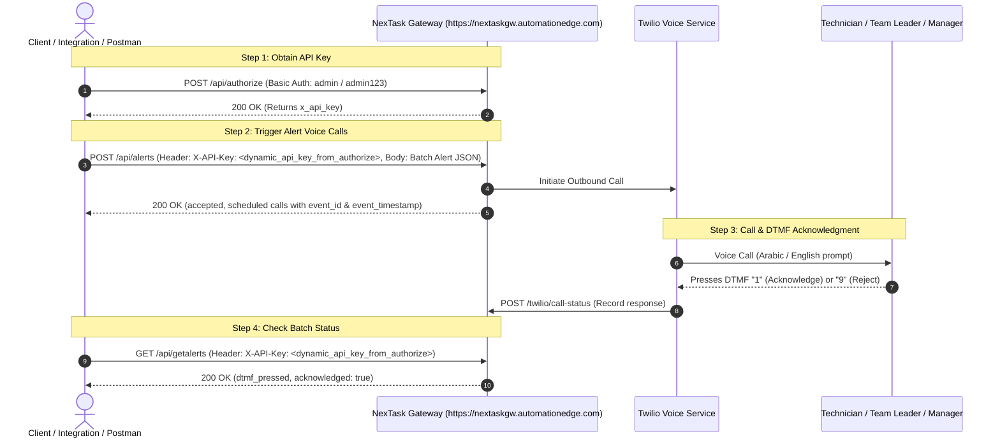

# NexTask Gateway API Documentation

**Base URL:** `https://nextaskgw.automationedge.com`  
**Authentication Scheme:** `Basic Auth` (to generate API key) & `X-API-Key` (for platform endpoints)

---

## Table of Contents
1. [Overview & Authentication Flow](#1-overview--authentication-flow)
2. [Authorization API (`/api/authorize`)](#2-authorization-api)
3. [Authentication API (`/api/authenticate`)](#3-authentication-api)
4. [Alert Intake API (`/api/alerts`)](#4-alert-intake-api)
5. [Payload Field Specifications & PostgreSQL Data Types](#5-payload-field-specifications--postgresql-data-types)
6. [Get Alerts API (`/api/getalerts`)](#6-get-alerts-api)
7. [Twilio Webhooks](#7-twilio-webhooks)
   - [Voice Callback (`/twilio/voice`)](#71-voice-callback)
   - [Call Status Callback (`/twilio/call-status`)](#72-status-callback)
8. [Error Handling & HTTP Status Codes](#8-error-handling--http-status-codes)

---

## 1. Overview & Authentication Flow



---

## 2. Authorization API

Authenticates admin credentials and returns the active API Key required for all subsequent requests.

* **Endpoint:** `/api/authorize`
* **Method:** `POST` or `GET`
* **Authentication:** **Basic Auth** (`admin` / `admin123`) or JSON Body (`{"username": "admin", "password": "admin123"}`)

### Request Headers
| Header | Value | Required |
| :--- | :--- | :--- |
| `Authorization` | `Basic <BASE64_ENCODED_CREDENTIALS>` | **Yes** (or JSON body) |
| `Content-Type` | `application/json` | If sending JSON body |

### Request Body (Optional if using Basic Auth)
```json
{
  "username": "admin",
  "password": "admin123"
}
```

### Success Response (`200 OK`)
```json
{
  "status": "success",
  "authorized": true,
  "http_code": 200,
  "message": "User authenticated successfully. Use the provided api_key in the headers of other APIs.",
  "api_key": "<dynamic_api_key_from_authorize>",
  "x_api_key": "<dynamic_api_key_from_authorize>",
  "token": "<SESSION_BEARER_TOKEN>",
  "token_type": "Bearer",
  "expires_in": 86400,
  "user": {
    "username": "admin",
    "role": "admin",
    "auth_type": "credentials"
  }
}
```

### Error Responses
* **`400 Bad Request`** (Missing credentials):
  ```json
  {
    "status": "error",
    "authorized": false,
    "http_code": 400,
    "error": "Bad Request: Missing credentials.",
    "message": "Please provide username and password via Basic Auth or JSON body to obtain your API Key."
  }
  ```
* **`401 Unauthorized`** (Invalid credentials):
  ```json
  {
    "status": "error",
    "authorized": false,
    "http_code": 401,
    "error": "Unauthorized: Invalid username or password.",
    "message": "The username or password provided is incorrect."
  }
  ```

---

## 3. Authentication API

Standard JWT-style authentication endpoint that issues a bearer session token.

* **Endpoint:** `/api/authenticate`
* **Method:** `POST`
* **Headers:** `Content-Type: application/json`

### Request Body
```json
{
  "username": "admin",
  "password": "admin123"
}
```

### Success Response (`200 OK`)
```json
{
  "status": "success",
  "message": "Authentication successful",
  "token": "<SESSION_BEARER_TOKEN>",
  "token_type": "Bearer",
  "expires_in": 86400,
  "api_key": "<dynamic_api_key_from_authorize>",
  "user": {
    "username": "admin",
    "role": "admin",
    "full_name": "admin"
  }
}
```

---

## 4. Alert Intake API

Ingests a single ticket or an entire batch of network/power/HVAC alerts, creates assignments, schedules escalation timers, and immediately triggers automated Twilio voice calls to the designated technicians.

* **Endpoint:** `/api/alerts` *(alias: `/api/alerts/intake`)*
* **Method:** `POST`
* **Authentication:** Header `X-API-Key: <dynamic_api_key_from_authorize>`

### Request Headers
| Header | Value | Required |
| :--- | :--- | :--- |
| `X-API-Key` | `<dynamic_api_key_from_authorize>` | **Yes** |
| `Content-Type` | `application/json` | **Yes** |

### Request Body (Batch Alert Payload)
```json
{
  "batch_id": "BATCH001",
  "event_timestamp": "2026-10-30T10:30:00+03:00",
  "branch": {
    "branch_id": "BR001",
    "branch_name": "Riyadh Main Office",
    "site_number": "SITE001"
  },
  "alerts": [
    {
      "event_id": "EVT001",
      "event_type": "ASSIGNMENT_CREATED",
      "event_version": 1,
      "alert_id": "ALT1001",
      "ticket": {
        "ticket_id": "INC1001",
        "alarm_id": "ALM5001",
        "issue_description": "Network connectivity failure",
        "alarm_type": "Network Failure",
        "severity": "Critical",
        "ticket_status": "Assigned",
        "alarm_status": "Active"
      },
      "assignment": {
        "assignment_id": "ASN001",
        "assignment_type": "INITIAL",
        "assigned_at": "2026-10-30T10:30:00+03:00"
      },
      "technician": {
        "technician_id": "ENG001",
        "name": "Ali",
        "mobile_number": "+966501234567",
        "preferred_language": "English"
      },
      "team_leader": {
        "team_leader_id": "TL001",
        "name": "Mohammed",
        "mobile_number": "+966501234568",
        "preferred_language": "English"
      },
      "manager": {
        "manager_id": "MGR001",
        "name": "Khalid",
        "mobile_number": "+966501234569",
        "preferred_language": "English"
      }
    }
  ]
}
```

### Success Response (`200 OK`)
Notice that the response includes **`event_id`** and **`event_timestamp`** at the result level and within the alert object for each alert:

```json
{
  "status": "success",
  "mode": "batch",
  "total": 1,
  "successful": 1,
  "failed": 0,
  "authorized": true,
  "auth": {
    "status": "authorized",
    "user": "api_admin",
    "role": "admin",
    "api_key_valid": true,
    "auth_type": "api_key"
  },
  "results": [
    {
      "index": 0,
      "ticket_id": "INC1001",
      "alert_id": "ALT1001",
      "event_id": "EVT001",
      "event_timestamp": "2026-10-30T10:30:00+03:00",
      "timestamp": "2026-10-30T10:30:00+03:00",
      "ack_digit": "1",
      "reject_digit": "9",
      "dtmf_pressed": null,
      "ack_number_pressed": null,
      "acknowledged": false,
      "status": "accepted",
      "http_code": 202,
      "actions": [
        "call workflow -> ASSIGNMENT_REASSIGNED",
        "tech_call #1 scheduled for 2026-10-30T10:30:00+03:00"
      ],
      "alert": {
        "ticket_id": "INC1001",
        "alert_id": "ALT1001",
        "alarm_id": "ALM5001",
        "event_id": "EVT001",
        "event_timestamp": "2026-10-30T10:30:00+03:00",
        "date_time": "2026-10-30T10:30:00+03:00",
        "site_name": "Riyadh Main Office",
        "site_number": "SITE001",
        "description": "Network connectivity failure",
        "technician_name": "Ali",
        "technician_number": "+9665XXXXXXXX",
        "severity": "Critical"
      }
    }
  ]
}
```

---

## 4.1 Push Records API (`/api/alerts`)

Stores single or batch ticket/task records directly into both PostgreSQL (`tb_tickets`, `tb_assignments`, `tb_nextask_events`, `tb_audit_logs`) and SQLite databases. All 17 fields from `table (1).tsv` are required.

* **Endpoint:** `/api/alerts` *(aliases: `/api/pushrecords`, `/api/push_records`)*
* **Method:** `POST` or `PUT`
* **Authentication:** Header `X-API-Key: <dynamic_api_key_from_authorize>`

### Request Body (Batch)
```json
{
  "tickets": [
    {
      "task_id": "TASK1001",
      "issue_description": "Network connectivity failure",
      "issue_type": "Network Failure",
      "severity": "Critical",
      "task_status": "Dispatch",
      "alarm_status": "Active",
      "site_number": "SITE001",
      "created_date": "2026-11-03T10:30:00+03:00",
      "technician_name": "Ali",
      "technician_mobile": "+966500000001",
      "technician_preferred_lang": "English",
      "teamleader_name": "Mohammed",
      "teamleader_mobile": "+966500000002",
      "teamleader_preferred_lang": "Arabic",
      "manager_name": "Khalid",
      "manager_mobile": "+966500000003",
      "manager_preferred_lang": "English"
    }
  ]
}
```

---

## 4.2 Update Records API (`/api/alerts/update`)

Updates existing ticket records for reassignments, status changes, or alarm clearance. Strictly follows `table (1).tsv`.

* **Endpoint:** `/api/alerts/update` *(aliases: `/api/update`, `/api/updaterecords`)*
* **Method:** `PUT` *(also accepts `POST`)*
* **Authentication:** Header `X-API-Key: <dynamic_api_key_from_authorize>`

### Request Body (Batch)
```json
{
  "updates": [
    {
      "task_id": "TASK1001",
      "update_type": "REASSIGNMENT",
      "technician_name": "Faisal",
      "technician_mobile": "+966500000007",
      "technician_preferred_lang": "Arabic"
    },
    {
      "task_id": "TASK1002",
      "update_type": "STATUS_UPDATE",
      "task_status": "Departed"
    },
    {
      "task_id": "TASK1003",
      "update_type": "STATUS_UPDATE",
      "task_status": "Closed",
      "alarm_status": "Cleared"
    }
  ]
}
```

### Response Example (`200 OK`)
```json
{
  "status": "success",
  "message": "Processed 3 update(s): 3 updated successfully, 0 failed",
  "records_count": 3,
  "success_count": 3,
  "failed_count": 0,
  "updates": [
    {
      "index": 0,
      "task_id": "TASK1001",
      "update_type": "REASSIGNMENT",
      "status": "updated",
      "new_assignment_id": "TASK1001-ASN3887",
      "technician": "Faisal (+966500000007)"
    },
    {
      "index": 1,
      "task_id": "TASK1002",
      "update_type": "STATUS_UPDATE",
      "status": "updated",
      "task_status": "Departed"
    },
    {
      "index": 2,
      "task_id": "TASK1003",
      "update_type": "STATUS_UPDATE",
      "status": "updated",
      "task_status": "Closed",
      "alarm_status": "Cleared"
    }
  ]
}
```

---

## 5. Payload Field Specifications & PostgreSQL Data Types

### 5.1 Additional Fields Summary

The following 7 fields are additional enhancements introduced in the NexTask Gateway batch architecture:

| No. | Additional field | Sample value | Purpose |
| :---: | :--- | :--- | :--- |
| 1 | `batch_id` | `BATCH001` | Identify a batch of alerts |
| 2 | `event_timestamp` (batch level) | `2026-10-30T10:30:00+03:00` | Record the batch timestamp |
| 3 | `branch.branch_id` | `BR001` | Identify the branch |
| 4 | `alert_id` | `ALT1001` | Separate alert reference |
| 5 | `assignment.assignment_type` | `INITIAL` / `REASSIGNMENT` | Identify assignment type |
| 6 | `assignment.assigned_at` | `2026-10-30T10:20:00+03:00` | Record assignment time |
| 7 | `assignment.previous_assignment_id` | `null` / `ASN001` | Identify the previous assignment during reassignment |

---

### 5.2 Field Comparison & PostgreSQL Data Types

Comparison between previous fields and current gateway payload fields, along with their PostgreSQL schema definitions (`FLMHelpdesk (1).sql`):

| Category | Previous Field | Additional / Gateway Field | Data Type | Sample Value | Purpose |
| :--- | :--- | :--- | :--- | :--- | :--- |
| **Batch** | *(none)* | `batch_id` | `VARCHAR(50)` | `BATCH001` | Group alerts in single payload |
| **Batch** | *(none)* | `event_timestamp` | `TIMESTAMPTZ` | `2026-10-30T10:30:00+03:00` | Batch creation timestamp |
| **Event** | `event_id` | `event_id` | `VARCHAR(50)` | `EVT001` | Unique event reference |
| **Event** | `event_type` | `event_type` | `VARCHAR(60)` | `ASSIGNMENT_REASSIGNED` | Lifecycle dispatch action |
| **Ticket** | `ticket_id` | `ticket.ticket_id` | `VARCHAR(50)` | `INC1001` | Incident ticket ID |
| **Ticket** | `alarm_id` | `ticket.alarm_id` | `VARCHAR(50)` | `ALM5001` | Alarm sensor reference |
| **Alert** | *(none)* | `alert_id` | `VARCHAR(50)` | `ALT1001` | Dedicated alert ID |
| **Site** | `site_name` | `branch.branch_name` | `VARCHAR(150)` | `Riyadh Main Office` | Physical facility name |
| **Site** | `site_number` | `branch.site_number` | `VARCHAR(50)` | `SITE001` | Branch/site code |
| **Site** | *(none)* | `branch.branch_id` | `VARCHAR(50)` | `BR001` | Branch database ID |
| **Assign** | `assignment_id` | `assignment.assignment_id` | `VARCHAR(50)` | `ASN002` | Current dispatch assignment |
| **Assign** | *(none)* | `assignment.assignment_type` | `VARCHAR(30)` | `REASSIGNMENT` | INITIAL vs REASSIGNMENT |
| **Assign** | *(none)* | `assignment.previous_assignment_id` | `VARCHAR(50)` | `null` / `ASN001` | Prior assignment reference |
| **Assign** | *(none)* | `assignment.assigned_at` | `TIMESTAMPTZ` | `2026-10-30T10:20:00+03:00` | Record assignment time |
| **Contact** | `technician_name` | `technician.name` | `VARCHAR(150)` | `Ali` | Field engineer name |
| **Contact** | `technician_mobile` | `technician.mobile_number` | `VARCHAR(30)` | `+966501234567` | Technician phone number (E.164 format) |
| **Contact** | *(none)* | `technician.preferred_language` | `VARCHAR(20)` | `English` / `Arabic` | Voice audio language |

> [!NOTE]
> Additional ticket context attributes (`ticket.issue_description`, `ticket.severity`, `ticket.alarm_type`) and escalation contacts (`team_leader`, `manager`) remain fully supported in the JSON payload and database columns (`tb_tickets`, `tb_assignments`).

---

## 6. Get Alerts API

Retrieves batch alert status, ticket delivery states, and DTMF interaction history without triggering calls.

* **Endpoint:** `/api/getalerts` *(also supports `GET /api/alerts`)*
* **Method:** `GET` *(or `POST`)*
* **Authentication:** Header `X-API-Key: <dynamic_api_key_from_authorize>`

### Request Headers
| Header | Value | Required |
| :--- | :--- | :--- |
| `X-API-Key` | `<dynamic_api_key_from_authorize>` | **Yes** |

### Success Response (`200 OK`)
```json
{
  "status": "success",
  "mode": "batch",
  "total": 3,
  "successful": 3,
  "failed": 0,
  "authorized": true,
  "auth": {
    "status": "authorized",
    "user": "api_admin",
    "role": "admin",
    "api_key_valid": true,
    "auth_type": "api_key"
  },
  "results": [
    {
      "index": 0,
      "ticket_id": "INC1001",
      "alert_id": "ALT1001",
      "event_id": "EVT001",
      "event_timestamp": "2026-10-30T10:30:00+03:00",
      "ack_digit": "1",
      "reject_digit": "9",
      "dtmf_pressed": "1",
      "ack_number_pressed": "1",
      "acknowledged": true,
      "status": "accepted",
      "http_code": 200,
      "alert": {
        "ticket_id": "INC1001",
        "site_name": "Riyadh Main Office",
        "severity": "Critical",
        "technician_name": "Ali",
        "technician_number": "+9665XXXXXXXX"
      }
    }
  ]
}
```

---

## 7. Twilio Webhooks

The platform exposes two public endpoints for Twilio Voice communications.

### 7.1 Voice Callback
* **Endpoint:** `/twilio/voice`
* **Method:** `POST`
* **URL:** `https://nextaskgw.automationedge.com/twilio/voice?cid={call_id}`
* **Purpose:** Returns the dynamic TwiML (XML) audio script when a call is answered by the technician.

### 7.2 Status Callback
* **Endpoint:** `/twilio/call-status`
* **Method:** `POST`
* **URL:** `https://nextaskgw.automationedge.com/twilio/call-status?cid={call_id}`
* **Purpose:** Receives real-time Twilio call progression events (`initiated`, `ringing`, `answered`, `completed`, `busy`, `no-answer`) and handles auto-escalation.

---

## 8. Error Handling & HTTP Status Codes

| HTTP Code | Name | Scenario |
| :---: | :--- | :--- |
| **`200`** | `OK` | Request succeeded (data retrieved or processed). |
| **`202`** | `Accepted` | Alert accepted and call placed in background queue. |
| **`400`** | `Bad Request` | Malformed JSON body or missing required alert fields. |
| **`401`** | `Unauthorized` | Missing or invalid `X-API-Key` or incorrect credentials. |
| **`404`** | `Not Found` | The requested route does not exist. |
| **`405`** | `Method Not Allowed` | E.g., sending `DELETE` or `PUT` to a POST-only endpoint. |
| **`500`** | `Internal Server Error` | Unhandled runtime server exception. |
