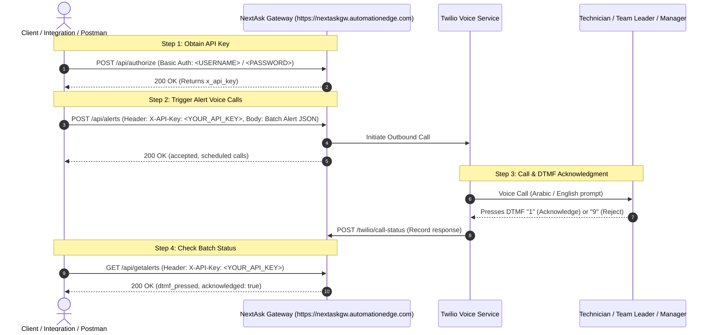

# NextAsk Gateway API Documentation

**Base URL:** `https://nextaskgw.automationedge.com`  
**Authentication Scheme:** `Basic Auth` (to generate API key) & `X-API-Key` (for platform endpoints)

---

## Table of Contents
1. [Overview & Authentication Flow](#1-overview--authentication-flow)
2. [Authorization API (`/api/authorize`)](#2-authorization-api)
3. [Authentication API (`/api/authenticate`)](#3-authentication-api)
4. [Alert Intake API (`/api/alerts`)](#4-alert-intake-api)
5. [Get Alerts API (`/api/getalerts`)](#5-get-alerts-api)
6. [Twilio Webhooks](#6-twilio-webhooks)
   - [Voice Callback (`/twilio/voice`)](#61-voice-callback)
   - [Call Status Callback (`/twilio/call-status`)](#62-status-callback)
7. [Error Handling & HTTP Status Codes](#7-error-handling--http-status-codes)

---

## 1. Overview & Authentication Flow



---

## 2. Authorization API

Authenticates admin credentials and returns the active API Key required for all subsequent requests.

* **Endpoint:** `/api/authorize`
* **Method:** `POST` or `GET`
* **Authentication:** **Basic Auth** (`<USERNAME>` / `<PASSWORD>`) or JSON Body (`{"username": "<USERNAME>", "password": "<PASSWORD>"}`)

### Request Headers
| Header | Value | Required |
| :--- | :--- | :--- |
| `Authorization` | `Basic <BASE64_ENCODED_CREDENTIALS>` | **Yes** (or JSON body) |
| `Content-Type` | `application/json` | If sending JSON body |

### Request Body (Optional if using Basic Auth)
```json
{
  "username": "<YOUR_USERNAME>",
  "password": "<YOUR_PASSWORD>"
}
```

### Success Response (`200 OK`)
```json
{
  "status": "success",
  "authorized": true,
  "http_code": 200,
  "message": "User authenticated successfully. Use the provided api_key in the headers of other APIs.",
  "api_key": "<YOUR_API_KEY>",
  "x_api_key": "<YOUR_API_KEY>",
  "token": "<SESSION_BEARER_TOKEN>",
  "token_type": "Bearer",
  "expires_in": 86400,
  "user": {
    "username": "<YOUR_USERNAME>",
    "role": "admin",
    "auth_type": "credentials"
  }
}
```

### Error Responses
* **`400 Bad Request`** (Missing credentials):
  ```json
  {
    "status": "error",
    "authorized": false,
    "http_code": 400,
    "error": "Bad Request: Missing credentials.",
    "message": "Please provide username and password via Basic Auth or JSON body to obtain your API Key."
  }
  ```
* **`401 Unauthorized`** (Invalid credentials):
  ```json
  {
    "status": "error",
    "authorized": false,
    "http_code": 401,
    "error": "Unauthorized: Invalid username or password.",
    "message": "The username or password provided is incorrect."
  }
  ```

---

## 3. Authentication API

Standard JWT-style authentication endpoint that issues a bearer session token.

* **Endpoint:** `/api/authenticate`
* **Method:** `POST`
* **Headers:** `Content-Type: application/json`

### Request Body
```json
{
  "username": "<YOUR_USERNAME>",
  "password": "<YOUR_PASSWORD>"
}
```

### Success Response (`200 OK`)
```json
{
  "status": "success",
  "message": "Authentication successful",
  "token": "<SESSION_BEARER_TOKEN>",
  "token_type": "Bearer",
  "expires_in": 86400,
  "api_key": "<YOUR_API_KEY>",
  "user": {
    "username": "<YOUR_USERNAME>",
    "role": "admin",
    "full_name": "<YOUR_USERNAME>"
  }
}
```

---

## 4. Alert Intake API

Ingests a single ticket or an entire batch of network/power/HVAC alerts, creates assignments, schedules escalation timers, and immediately triggers automated Twilio voice calls to the designated technicians.

* **Endpoint:** `/api/alerts` *(alias: `/api/alerts/intake`)*
* **Method:** `POST`
* **Authentication:** Header `X-API-Key: <YOUR_API_KEY>`

### Request Headers
| Header | Value | Required |
| :--- | :--- | :--- |
| `X-API-Key` | `<YOUR_API_KEY>` | **Yes** |
| `Content-Type` | `application/json` | **Yes** |

### Request Body (Batch Alert Payload)
```json
{
  "batch_id": "BATCH001",
  "event_timestamp": "2026-10-30T10:30:00+03:00",
  "branch": {
    "branch_id": "BR001",
    "branch_name": "Riyadh Main Office",
    "site_number": "SITE001"
  },
  "alerts": [
    {
      "event_id": "EVT001",
      "event_type": "ASSIGNMENT_REASSIGNED",
      "event_version": 2,
      "alert_id": "ALT1001",
      "ticket": {
        "ticket_id": "INC1001",
        "alarm_id": "ALM5001",
        "issue_description": "Network connectivity failure",
        "alarm_type": "Network Failure",
        "severity": "Critical",
        "ticket_status": "Assigned",
        "alarm_status": "Active"
      },
      "assignment": {
        "assignment_id": "ASN002",
        "assignment_type": "REASSIGNMENT",
        "previous_assignment_id": "ASN001",
        "assigned_at": "2026-10-30T10:30:00+03:00"
      },
      "technician": {
        "technician_id": "ENG002",
        "name": "Ali",
        "mobile_number": "+9665XXXXXXXX",
        "preferred_language": "English"
      },
      "team_leader": {
        "team_leader_id": "TL001",
        "name": "Mohammed",
        "mobile_number": "+9665XXXXXXXX",
        "preferred_language": "English"
      },
      "manager": {
        "manager_id": "MGR001",
        "name": "Khalid",
        "mobile_number": "+9665XXXXXXXX",
        "preferred_language": "English"
      },
      "acknowledgement": {
        "dtmf_digit": "1"
      }
    }
  ]
}
```

### Success Response (`200 OK`)
```json
{
  "status": "success",
  "mode": "batch",
  "total": 1,
  "successful": 1,
  "failed": 0,
  "authorized": true,
  "auth": {
    "status": "authorized",
    "user": "api_admin",
    "role": "admin",
    "api_key_valid": true,
    "auth_type": "api_key"
  },
  "results": [
    {
      "index": 0,
      "ticket_id": "INC1001",
      "alert_id": "ALT1001",
      "ack_digit": "1",
      "reject_digit": "9",
      "dtmf_pressed": null,
      "acknowledged": false,
      "status": "accepted",
      "http_code": 202,
      "actions": [
        "call workflow -> ASSIGNMENT_REASSIGNED",
        "tech_call #1 scheduled for 2026-10-30T10:30:00+03:00"
      ],
      "alert": {
        "ticket_id": "INC1001",
        "alert_id": "ALT1001",
        "alarm_id": "ALM5001",
        "site_name": "Riyadh Main Office",
        "site_number": "SITE001",
        "description": "Network connectivity failure",
        "technician_name": "Ali",
        "technician_number": "+9665XXXXXXXX"
      }
    }
  ]
}
```

### Unauthorized Response (`401 Unauthorized`)
```json
{
  "status": "error",
  "authorized": false,
  "http_code": 401,
  "error": "Unauthorized: Missing or invalid API Key.",
  "message": "Please provide 'X-API-Key: <YOUR_API_KEY>' in request headers.",
  "required_header": "X-API-Key"
}
```

---

## 5. Get Alerts API

Retrieves batch alert status, ticket delivery states, and DTMF interaction history without triggering calls.

* **Endpoint:** `/api/getalerts` *(also supports `GET /api/alerts`)*
* **Method:** `GET` *(or `POST`)*
* **Authentication:** Header `X-API-Key: <YOUR_API_KEY>`

### Request Headers
| Header | Value | Required |
| :--- | :--- | :--- |
| `X-API-Key` | `<YOUR_API_KEY>` | **Yes** |

### Success Response (`200 OK`)
```json
{
  "status": "success",
  "mode": "batch",
  "total": 3,
  "successful": 3,
  "failed": 0,
  "authorized": true,
  "auth": {
    "status": "authorized",
    "user": "api_admin",
    "role": "admin",
    "api_key_valid": true,
    "auth_type": "api_key"
  },
  "results": [
    {
      "index": 0,
      "ticket_id": "INC1001",
      "alert_id": "ALT1001",
      "ack_digit": "1",
      "reject_digit": "9",
      "dtmf_pressed": "1",
      "ack_number_pressed": "1",
      "acknowledged": true,
      "status": "accepted",
      "http_code": 200,
      "alert": {
        "ticket_id": "INC1001",
        "site_name": "Riyadh Main Office",
        "severity": "Critical",
        "technician_name": "Ali",
        "technician_number": "+9665XXXXXXXX"
      }
    }
  ]
}
```

---

## 6. Twilio Webhooks

The platform exposes two public endpoints for Twilio Voice communications.

### 6.1 Voice Callback
* **Endpoint:** `/twilio/voice`
* **Method:** `POST`
* **URL:** `https://nextaskgw.automationedge.com/twilio/voice?cid={call_id}`
* **Purpose:** Returns the dynamic TwiML (XML) audio script when a call is answered by the technician.

### 6.2 Status Callback
* **Endpoint:** `/twilio/call-status`
* **Method:** `POST`
* **URL:** `https://nextaskgw.automationedge.com/twilio/call-status?cid={call_id}`
* **Purpose:** Receives real-time Twilio call progression events (`initiated`, `ringing`, `answered`, `completed`, `busy`, `no-answer`) and handles auto-escalation.

---

## 7. Error Handling & HTTP Status Codes

| HTTP Code | Name | Scenario |
| :---: | :--- | :--- |
| **`200`** | `OK` | Request succeeded (data retrieved or processed). |
| **`202`** | `Accepted` | Alert accepted and call placed in background queue. |
| **`400`** | `Bad Request` | Malformed JSON body or missing required alert fields. |
| **`401`** | `Unauthorized` | Missing or invalid `X-API-Key` or incorrect credentials. |
| **`404`** | `Not Found` | The requested route does not exist. |
| **`405`** | `Method Not Allowed` | E.g., sending `DELETE` or `PUT` to a POST-only endpoint. |
| **`500`** | `Internal Server Error` | Unhandled runtime server exception. |
